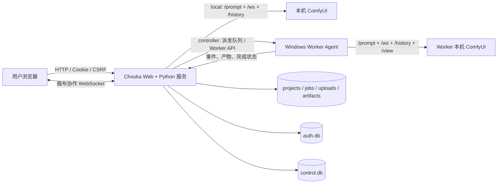
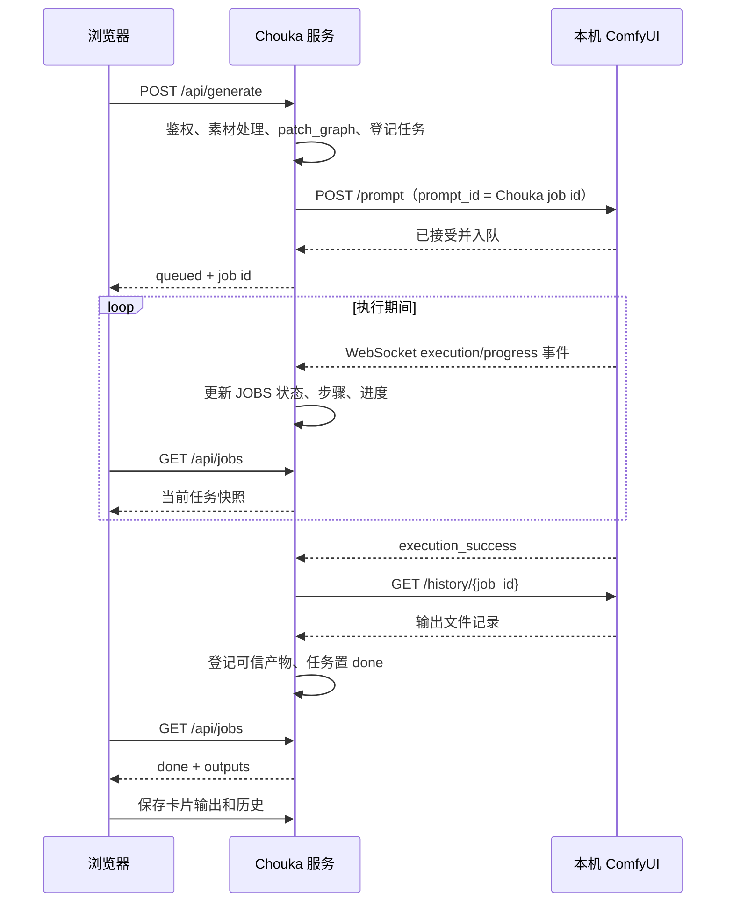
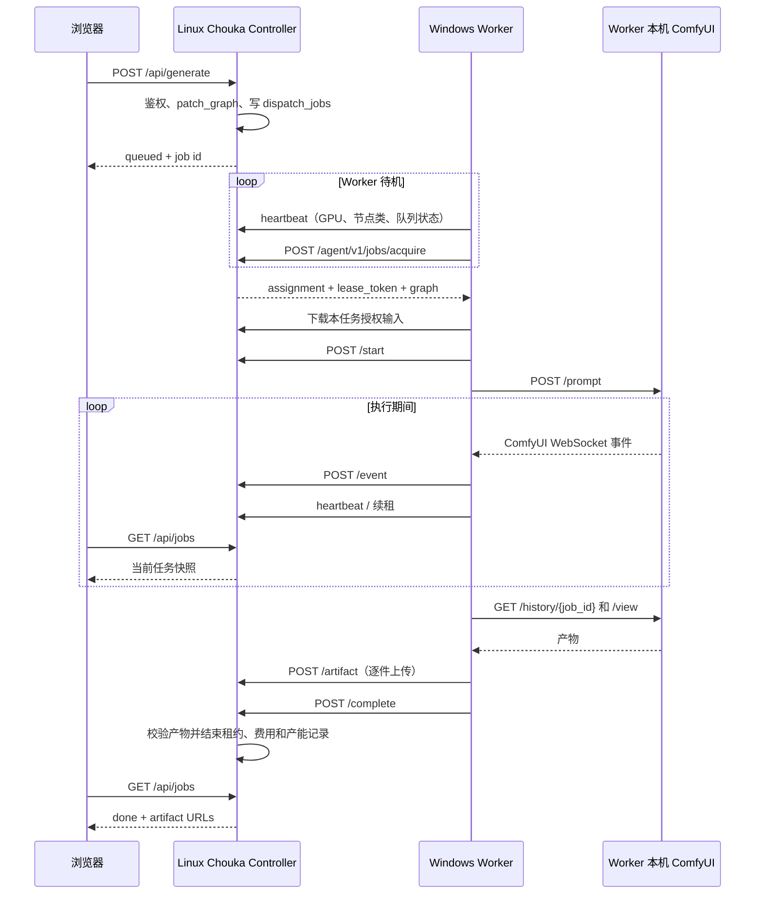
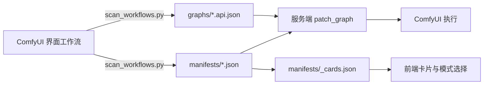

# Chouka 抽卡系统技术链路说明

> 面向对象：需要接手、维护或扩展 Chouka 的开发同事  
> 文档依据：当前仓库代码，更新于 2026-10-12  
> 系统目录：`chouka/`

## 1. 文档目标

本文用于回答以下问题：

1. Chouka 在整个生成系统中承担什么职责；
2. 浏览器、Chouka 服务、ComfyUI、Windows Worker 如何协作；
3. 一次生图或生视频任务从点击“运行”到产物展示经过哪些步骤；
4. 画布、任务、账号、资源、费用和产能数据分别存在哪里；
5. 新增工作流、模型、节点或业务功能时需要修改哪些模块；
6. 出现任务排队、进度异常、产物缺失或权限问题时应从哪里排查。

本文重点描述**当前代码事实**。历史设计文档可能反映旧版本，最终应以代码、`manifests/`、`graphs/` 和 `pricing.json` 为准。

---

## 2. 一句话理解 Chouka

Chouka 是构建在 ComfyUI 之上的多人 Web 创作与任务调度系统：

- **Chouka 前端**提供画布、参数面板、导演台、任务和历史界面；
- **Chouka 服务端**负责账号权限、画布存储、工作流参数注入、任务状态、资源访问和费用统计；
- **ComfyUI**仍是实际执行模型和节点图的引擎；
- **Windows Worker**让 Linux 控制端可以把任务派发给多台带 GPU 的 Windows 机器。

Chouka 不替代 ComfyUI 的节点执行器，而是在其外部增加产品化界面、任务治理和分布式调度。

---

## 3. 系统边界与核心角色

### 3.1 四层结构



### 3.2 各角色职责

| 角色 | 主要职责 | 不负责的内容 |
|---|---|---|
| 浏览器前端 | 画布编辑、参数收集、提交任务、轮询任务、展示产物、多人光标和画布变更 | 不直接连接 ComfyUI，不负责 GPU 调度 |
| Chouka 服务端 | 鉴权、项目权限、工作流修补、任务登记、资源隔离、本地执行接入、分布式调度入口、费用与产能统计 | 不执行模型算子 |
| ComfyUI | 校验 API graph、排队、执行节点、发送执行事件、记录 history、提供产物 | 不理解 Chouka 账号、项目组或零售价 |
| Windows Worker | 注册与心跳、上报能力、领取任务、下载输入、调用本机 ComfyUI、上传产物 | 不保存全局账号和项目数据 |

### 3.3 两种执行模式

#### 本地模式 `local`

适合单机开发和本地体验。Chouka 服务与 ComfyUI 通常运行在同一台 Windows 机器：

- 启动入口：`启动抽卡系统.bat`；
- Chouka 直接调用 `CHOUKA_COMFY_URL` 指向的 ComfyUI；
- 服务端直接监听 ComfyUI WebSocket；
- 默认脚本开启 `CHOUKA_LOCAL_TEST=1`，只允许本机回环地址免登录测试。

关键代码：

- `server/boot.py:45-70`：检查和拉起 ComfyUI；
- `server/app.py:643-663`：提交 `/prompt`；
- `server/app.py:818-939`：处理 ComfyUI WebSocket 事件；
- `server/auth.py:154-188`：本机免登录边界。

#### 控制端模式 `controller`

适合 Linux 控制端加多台 Windows GPU 节点：

- 控制端保存用户、项目、派发队列和产物；
- Windows Worker 主动注册、心跳并领取任务；
- Worker 调用本机 ComfyUI 执行；
- 任务输入从控制端下载，结果上传回控制端；
- 浏览器始终访问控制端，不直接访问 Worker 或 Worker 上的 ComfyUI。

关键代码：

- `compose.controller.yml`、`Dockerfile.controller`、`start-controller.sh`：控制端部署入口；
- `worker/agent.py`：Windows Worker；
- `server/distributed.py`：Worker、派发队列和租约；
- `server/app.py:1508-1849`：`/agent/v1/*` Worker API。

> 当前仓库的 Worker 实现和同步流程明确面向 Windows。Linux 是控制端部署目标，不应据此假设 Linux Worker 已受支持。

---

## 4. 代码目录地图

```text
chouka/
├─ server/
│  ├─ app.py                 # aiohttp 服务入口、主要 API、本地/远程任务编排
│  ├─ auth.py                # 会话、CSRF、页面/API 权限中间件
│  ├─ auth_store.py          # 用户、会话、项目 ACL、任务 ACL、项目组
│  ├─ distributed.py         # Worker 注册、心跳、调度、租约、取消
│  ├─ resource_access.py     # 上传和产物的可信资源索引及访问控制
│  ├─ capacity.py            # 产能任务、观测与报告
│  ├─ costs.py               # 成本与建议零售价统计
│  ├─ director_bridge.py     # 导演台与画布节点/任务的桥接
│  ├─ edit_api.py            # 导演台剪辑文档和导出 API
│  ├─ scan_workflows.py      # 从 ComfyUI 工作流生成 graph/manifest/card 定义
│  └─ migrations/            # auth.db 的 SQLite 迁移
├─ web/
│  ├─ index.html             # 创作画布页面
│  ├─ app.js                 # 画布、节点、参数、任务、历史、协作主逻辑
│  ├─ auth.js                # 登录态、CSRF、账号栏和统一请求封装
│  ├─ director.html/js       # 导演工作台
│  ├─ director_edit.js       # 剪辑与导出前端
│  ├─ controller.html        # Worker/任务控制面板
│  ├─ costs.html             # 费用页面
│  ├─ capacity.html          # 产能页面
│  └─ permissions.html       # 账号和授权管理
├─ worker/
│  ├─ agent.py               # Windows Worker Agent
│  ├─ config.example.json    # Worker 配置样例
│  └─ start-worker.bat       # 独立启动 Worker
├─ graphs/                   # 可提交给 ComfyUI 的 API graph
├─ manifests/                # 能力、输入控件、参数到图节点的映射
├─ data/                     # 运行时项目、任务、数据库、上传和产物
├─ tests/                    # 后端、调度、权限、工作流及部分前端测试
├─ pricing.json              # 成本和建议零售价规则
└─ 启动*.bat / start-*.sh    # 本地、Worker、控制端启动入口
```

### 4.1 前端技术特点

前端使用原生 HTML、CSS 和 JavaScript，无必须运行的独立前端构建服务：

- 页面静态资源由 `server/app.py` 提供；
- `web/app.js` 使用模块级变量维护画布和任务状态；
- 节点能力、参数和素材槽主要由 `/api/cards` 动态下发；
- 前端不应为每个普通新工作流复制一套页面逻辑。

### 4.2 后端技术特点

- Web 框架：`aiohttp`；
- 持久化：JSON 文件和 SQLite；
- 实时通道：浏览器画布协作 WebSocket、服务端/Worker 到 ComfyUI WebSocket；
- 浏览器生成进度：HTTP 轮询，不是 WebSocket/SSE；
- 分布式任务：Worker 拉取模式和租约机制。

---

## 5. 前端用户操作链路

### 5.1 页面启动

画布入口为 `/`，页面加载 `web/index.html`、`web/auth.js` 和 `web/app.js`。

`boot()` 的主要步骤见 `web/app.js:1131-1177`：

1. 请求 `/api/auth/me` 获取当前用户与 CSRF token；
2. 请求 `/api/cards` 获取卡片定义和能力清单；
3. 请求 `/api/projects` 加载个人、共享和项目组画布；
4. 打开 URL 指定的项目，或进入默认画布；
5. 启动健康检查、项目刷新和任务轮询；
6. 打开项目后连接协作 WebSocket。

前端主要轮询频率：

- 健康状态：约 5 秒；
- 项目列表：约 5 秒；
- 任务列表：约 700 毫秒；
- 导演台任务：约 1.8 秒。

### 5.2 创建和编辑画布节点

节点来源包括：

- 文本、图片、视频等基础素材卡；
- 生图、生视频及工具类生成卡；
- 服务端通过 `manifests/_cards.json` 聚合出的能力；
- 右键菜单或底部工具栏创建入口。

创建节点时，前端先把节点乐观加入 `PROJ.cards` 并绘制，再调用：

```http
POST /api/projects/{project_id}/cards
```

失败时回滚本地节点。主要代码见 `web/app.js:3130-3229`、`3483-3515`、`3951-4018`。

画布支持：

- 节点拖动、缩放、框选和分组；
- 节点连线和素材槽自动匹配；
- 复制、粘贴、撤销、重做；
- 画布平移、缩放和小地图；
- 文件拖入画布并转成素材节点；
- 多人光标与远端画布变更。

### 5.3 参数面板如何生成

选中生成节点后，`openPanel()` 根据当前卡片和能力定义动态渲染参数，见 `web/app.js:4895-5095`。

参数来源主要是 manifest：

```json
{
  "id": "example_capability",
  "graph": "graphs/example_capability.api.json",
  "inputs": [
    {
      "key": "prompt",
      "label": "提示词",
      "type": "textarea",
      "target": { "node": "12", "input": "text" }
    }
  ]
}
```

含义是：前端显示 `prompt` 文本域；提交时服务端把它写入 API graph 的节点 `12`、输入 `text`。

因此，普通能力的参数展示和图参数绑定主要由 manifest 驱动，而不是散落在前后端的硬编码表。

### 5.4 画布保存

用户编辑内容后：

- `save()` 约 700 毫秒防抖；
- 通过串行 `saveChain` 提交，避免并发写回乱序；
- 整份保存 `name/cards/edges/groups/rev`；
- 服务端用 `rev` 做乐观并发控制；
- 返回 409 时普通画布会重新加载。

接口：

```http
PUT /api/projects/{project_id}
```

代码位置：

- `web/app.js:1511-1585`；
- `server/app.py:2643-2698`。

每个用户的画布视图位置独立保存：

```http
PUT /api/projects/{project_id}/view
```

视图保存与画布内容保存是两条链，见 `server/app.py:2372-2391`。

### 5.5 提交生成任务

点击节点“运行”后，`payloadOf()` 和 `runCard()` 完成以下工作，见 `web/app.js:7341-7423`：

1. 确定节点当前实际选择的能力、模式和模型；
2. 合并 manifest 默认值与用户参数；
3. 收集提示词、seed、素材槽和预设；
4. 解析提示词中的关联内容；
5. 合并文本卡、风格卡和导演镜头补充；
6. 将节点本地状态置为 `queued`；
7. 调用：

```http
POST /api/generate
Content-Type: application/json

{
  "project": "...",
  "card": "...",
  "capability": "...",
  "params": { "...": "..." },
  "assets": { "...": "..." }
}
```

8. 接收任务 ID 和 seed，并绑定到当前卡片。

### 5.6 进度与结果展示

浏览器不直接监听 ComfyUI 的执行 WebSocket。它周期调用：

```http
GET /api/jobs
```

并根据返回状态更新：

- 节点上的排队、步骤和百分比；
- 顶部任务数量；
- 任务浮窗；
- 错误信息；
- 节点输出和右侧历史；
- 下游未固定版本的素材槽。

任务轮询入口见 `web/app.js:7432`，后续逻辑负责把任务状态和输出同步到当前画布。

单卡历史最多保留 20 轮，包含：

- 输出 URL；
- seed；
- 耗时；
- 提交时提示词快照；
- 任务状态和相关元数据。

历史随画布 JSON 保存，而不是从 `jobs.json` 无限恢复。

### 5.7 多人协作通道

打开画布后，浏览器连接：

```text
ws(s)://<host>/api/projects/{project_id}/presence
```

它承载：

- 在线成员；
- 协作者光标；
- `card-added`；
- `project-changed`；
- `project-deleted`。

前端实现见 `web/app.js:1650-1840`，服务端实现见 `server/app.py:2557-2620`。

> 该 WebSocket 只用于画布协作，不用于生成任务进度。

---

## 6. 服务端收到生成请求后的共同链路

`POST /api/generate` 的主实现见 `server/app.py:1047-1172`。

### 6.1 鉴权与串行化

请求先经过 `server/auth.py`：

1. 校验浏览器会话 Cookie；
2. 对写请求校验同源 `Origin/Referer`；
3. 校验 `X-CSRF-Token`；
4. 检查用户是否拥有目标项目的 `operate` 权限；
5. 校验请求中的素材是否属于用户可访问的可信资源。

生成请求还按项目获取写锁，避免同一项目的关键写操作相互覆盖，见 `server/app.py:223-234`。

### 6.2 素材准备

上传接口：

```http
POST /api/upload?project={project_id}
```

服务端会：

1. 在资源索引中登记 `pending`；
2. 写入 `data/uploads/`；
3. 完成后发布为 `ready`；
4. 本地模式按需要把图片/音频传给 ComfyUI；
5. 对视频执行兼容性处理；
6. 将本次任务允许访问的输入登记到 `job_inputs`。

关键实现：

- `server/app.py:379-391`；
- `server/app.py:959-1044`；
- `server/resource_access.py:262-304`。

### 6.3 API graph 修补

服务端读取能力指定的 `graphs/*.api.json`，深拷贝后执行 `patch_graph()`，见 `server/app.py:564-640`。

修补内容包括：

- 将用户参数写入 manifest 指定的节点输入；
- 注入或随机化 seed；
- 校验必填素材；
- 清理未使用的可选素材支线；
- 处理空文本和图像控制；
- 应用少量能力特定规则。

生成提交的是本次任务的图快照。后续 manifest 或模板变更不会倒改已经入队任务的 graph。

### 6.4 建立任务身份

服务端生成 UUID 作为任务 ID，并登记：

- 项目和用户归属；
- 任务 ACL；
- 输入资源白名单；
- 能力、模型族和参数快照；
- 所需 ComfyUI 节点类；
- GPU 和容量要求；
- 前端展示用的 `JOBS` 记录。

之后根据执行模式进入本地执行或控制端派发。

---

## 7. 本地模式完整时序



### 7.1 提交与排队

`server/app.py:643-685` 调用 ComfyUI `/prompt`：

- Chouka 的 job ID 同时作为 ComfyUI `prompt_id`；
- `comfy_lock` 串行处理提交确认；
- ComfyUI 会先校验 graph，再放入自己的执行队列；
- HTTP 返回 `queued` 只代表已提交，不代表执行完成。

### 7.2 进度采集

Chouka 常驻连接 ComfyUI：

```text
/ws?clientId=<固定客户端ID>
```

服务端处理：

- `execution_start`：任务变为 `running`；
- `executing`：更新当前节点和中文步骤；
- `progress_state`：按节点权重计算整图进度；
- `execution_cached`：标记缓存命中的节点；
- `execution_error`：任务进入错误状态；
- 完成事件：进入 history 归集阶段。

整图进度只增不减，完成归集前最多显示约 99%，防止 ComfyUI 已执行完但产物还未可信落盘时前端提前显示完成。

### 7.3 结果归集

完成事件后，服务端通过：

```http
GET {COMFY_URL}/history/{job_id}
```

读取输出记录，再生成经过 Chouka 授权的访问 URL。浏览器访问本地产物时走：

```http
GET /api/file?... 
```

由 Chouka 验权后代理 ComfyUI `/view`，浏览器不需要直接访问 8188。

服务端会有限次数等待 history 写入；无可用产物时任务标为错误，而不是假定成功。

### 7.4 本地取消

取消任务时，Chouka 按任务 ID 请求 ComfyUI 取消，并等待显存清理确认。确认前会阻止新的本地提交，避免旧任务仍占用设备却继续叠加任务。由于本地执行器的运行中中断具有全局影响，普通用户即使拥有项目 `operate` 权限，也不能取消已经进入 `running` 的本地任务；该操作要求管理员权限。

入口：

```http
POST /api/job/{job_id}/cancel
```

主要实现见 `server/app.py:1932-1992`。

---

## 8. Controller + Windows Worker 完整时序



### 8.1 Worker 首次注册与长期身份

首次启动时，Worker 使用 `config.json` 中的 enrollment token 调用：

```http
POST /agent/v1/register
```

注册成功后，Worker 保存自己的：

- Worker ID；
- Worker token；
- 主机标识；
- 其他运行状态。

默认状态文件为 `worker/worker-state.json`。后续请求使用：

- `X-Worker-ID`；
- `Authorization: Bearer <worker-token>`；
- 操作具体任务时再附带 `X-Lease-Token`。

控制端只保存 Worker token 的 SHA-256 哈希。

### 8.2 能力扫描与心跳

Worker 周期访问本机 ComfyUI：

- `/system_stats`：系统和设备信息；
- `/object_info`：已注册的节点类；
- `/queue`：本地队列占用情况。

再向控制端报告：

- 在线状态；
- GPU 型号、显存和可用性；
- 已安装的 ComfyUI 节点类；
- 当前任务和租约；
- 是否正在同步；
- 模型/能力缓存信息。

关键实现见 `worker/agent.py:235-293`、`380-437`。

### 8.3 调度资格

`server/distributed.py:379-475` 只会把任务派给满足下列条件的 Worker：

1. 已启用且在线；
2. 当前空闲；
3. 不处于节点/模型同步状态；
4. 包含 graph 所需的全部 `class_type`；
5. 满足任务的 GPU/显存策略；
6. 租约和 Worker 状态允许接单。

满足基本条件后，调度还会考虑同能力或同模型族缓存亲和性，减少频繁切换模型带来的加载成本。

### 8.4 租约机制

Worker 领取任务后获得 `lease_token`。租约用于避免：

- 两个 Worker 同时执行同一任务；
- Worker 重启后继续上报已经失效的旧任务；
- 网络分区中的迟到事件覆盖新一轮调度结果。

Worker 通过心跳续租。租约过期后控制端可释放 Worker 并重新入队；Worker 本地达到续租截止时间时会主动停止旧执行。

### 8.5 输入下载

Worker 只能下载当前租约任务在 `job_inputs` 中登记的输入。控制端和 Worker 都会检查路径，防止通过文件名越界访问其他文件。

下载入口位于 `/agent/v1/jobs/...`，服务端校验 Worker 身份、任务租约和输入白名单；Worker 实现见 `worker/agent.py:494-531`。

### 8.6 执行和事件回传

Worker 在本机：

1. 下载输入到 ComfyUI input 目录；
2. 调用控制端 `/start` 标记运行；
3. 向本机 ComfyUI `/prompt` 提交 graph；
4. 监听本机 ComfyUI WebSocket；
5. 将关键进度、错误和中断事件发送到控制端 `/event`；
6. 心跳续租。

普通进度事件会节流，错误和中断立即上报。控制端会把事件中的 prompt ID 约束到当前租约任务，防止 Worker 冒充其他任务。

### 8.7 产物上传与完成

ComfyUI 执行结束后，Worker：

1. 查询本机 `/history/{job_id}`；
2. 从 `/view` 下载输出文件；
3. 逐件调用 `/artifact` 上传；
4. 调用 `/complete` 报告最终输出列表。

控制端将文件写到：

```text
data/artifacts/{job_id}/
```

每件文件先登记为 `pending`，写入并复核租约和项目有效性后才发布为 `ready`。`/complete` 还会验证所有输出 URL 确实属于当前任务已发布的 artifact。

远程模式中，ComfyUI 的执行完成事件只会把进度推进到“正在归集产物”；真正的成功终态以 Worker `/complete` 为准。

### 8.8 分布式取消

- 尚未领取的排队任务：可直接取消；
- 已领取或运行中的任务：进入 `cancel_requested`；
- Worker 在心跳中收到取消命令；
- Worker 关闭监听，按任务 ID 取消本机 ComfyUI，并等待资源释放；
- Worker 向控制端报告失败/取消终态；
- 若本地资源释放无法确认，Worker 会停止继续接单。

---

## 9. 数据与持久化

Chouka 同时使用 JSON 文件和 SQLite。维护时要先确认问题属于“前端画布状态”“展示任务状态”“调度队列”还是“资源索引”，不能只看一个文件。

### 9.1 数据总览

| 数据 | 默认位置 | 用途与注意事项 |
|---|---|---|
| 画布项目 | `data/projects/<id>.json` | 保存卡片、连线、分组、卡片历史、版本号等 |
| 近期任务展示 | `data/jobs.json` | 只保存最近约 60 条，供重启恢复与页面展示，不是完整审计账本 |
| 用户上传 | `data/uploads/` | 私有输入资源，访问受资源索引和项目权限控制 |
| 本地模式产物 | ComfyUI 自身的 output 目录 | Chouka 通常通过 `/api/file` 代理 ComfyUI `/view`；不在 `data/artifacts/` 中 |
| 分布式产物 | `data/artifacts/<job-id>/` | Worker 上传到控制端的结果 |
| 账号权限库 | `data/auth.db` | 用户、会话、项目 ACL、任务 ACL、项目组、分享、资源索引 |
| 控制端运行库 | `data/control.db` | Worker、派发任务、租约、产能、费用事件 |
| Worker 本地身份 | `worker/worker-state.json` | Worker ID、凭据和主机状态，不能当公开样例提交 |
| 节点扫描缓存 | `data/object_info.json`、`data/zh_nodes.json` | 工作流扫描与中文节点信息 |

### 9.2 画布 JSON

项目读取和创建见 `server/app.py:2045-2142`，整份保存见 `server/app.py:2643-2698`。

典型项目中包含：

- `id`、`name`、`rev`；
- `cards`：节点、参数、状态、输出和历史；
- `edges`：节点连接；
- `groups`：分组；
- 导演台和剪辑相关文档由对应 API 维护；
- 个人视图单独保存，不应覆盖其他协作者的画布位置。

`rev` 用于乐观锁。开发新保存接口时，应明确它修改的是整份画布、用户视图还是独立子文档，避免多个编辑器互相覆盖。

### 9.3 `jobs.json` 与调度队列的区别

`server/app.py` 中的 `JOBS` 是前端展示层任务快照，持久化到 `data/jobs.json`，只保留最近约 60 条。

控制端真正用于领取和租约恢复的任务位于 `control.db` 的 `dispatch_jobs` 等表中，由 `server/distributed.py` 维护。

因此：

- 页面任务列表缺少旧任务，不等于任务从所有数据库消失；
- 排查“任务一直排队”时必须查看派发库和 Worker 心跳；
- 排查“页面状态与实际队列不一致”时要同时比较 `JOBS` 和 `dispatch_jobs`；
- 计费历史也不能只依赖 `jobs.json`。

### 9.4 资源索引

`server/resource_access.py` 把文件与权限绑定，而不是依赖“知道 URL 就能访问”。资源通常经历：

```text
pending → 文件写入和校验 → ready → 授权访问
```

索引记录：

- 资源类型和真实路径；
- 所属用户或项目；
- 关联任务；
- 当前发布状态；
- 本任务允许下载的输入。

备份时要同时考虑资源文件和 `auth.db` 中的索引。如果只恢复文件、不恢复索引，服务端仍可能拒绝访问；反之只有索引没有文件也无法恢复产物。对于 local 模式，还必须单独备份 ComfyUI 的 output 目录；`data/comfy-cache/` 只覆盖受控复制等缓存场景，不能代替完整的本地产物备份。

### 9.5 重启恢复

本地模式与控制端模式不同：

- 本地模式下，重启前仍为 `queued/running` 的任务通常标记取消；
- 已收到完成事件、仅等待 history 归集的本地任务会做有限恢复，但不会重新提交 prompt；
- 控制端派发队列持久化在 SQLite，可继续依靠租约过期和 Worker 重连处理；
- Worker 旧租约事件必须被拒绝，防止重启后的迟到结果覆盖当前任务。

---

## 10. 认证、授权与资源安全

### 10.1 浏览器会话

浏览器统一通过 `web/auth.js` 访问 API：

- 会话 Cookie 为 HttpOnly；
- 写请求携带 `X-CSRF-Token`；
- 401 触发登录失效处理；
- 403/404 触发访问拒绝处理；
- 前端不会从 JavaScript 读取 HttpOnly Cookie。

服务端在 `server/auth.py:191-287` 校验会话、来源和 CSRF。

### 10.2 项目权限

项目权限最终由服务端判断。常见等级：

- `operate`：可编辑并运行；
- `read`：只读；
- 无权限：不可访问。

权限来源可能是：

- 管理员；
- 画布所有者；
- 项目组成员；
- 直接分享；
- 组分享；
- 所有者授权。

前端隐藏按钮只是交互优化，不是安全边界。每个写接口、任务接口和文件接口仍应服务端校验。

### 10.3 试玩画布与只读画布

两者不能混同：

- 普通只读画布不允许修改或运行；
- 锁定的试玩画布允许在当前会话中试改和试跑现有节点，但修改不持久化；
- 试玩能力不能被误用为正式共享权限绕过。

### 10.4 Worker 认证

Worker API 不使用浏览器 Cookie/CSRF，而使用独立凭据：

1. enrollment token 只用于首次注册；
2. 后续使用 Worker ID 和 Worker token；
3. 具体任务操作再验证租约 token；
4. 产物、输入、事件都绑定到当前任务。

Worker 与用户是两套完全不同的身份体系。

### 10.5 本地免登录模式

`CHOUKA_LOCAL_TEST=1` 仅用于本机开发：

- 必须监听回环地址；
- 使用独立测试账号库；
- 禁止账号管理和 Worker 接口；
- 写请求仍做来源和 CSRF 检查。

不得把本地启动脚本直接改成局域网公开服务并继续使用免登录配置。

---

## 11. 工作流、Graph 与 Manifest

### 11.1 三类文件的关系



- **界面工作流**：方便在 ComfyUI 中设计和验证；
- **API graph**：可直接提交给 `/prompt` 的执行图；
- **manifest**：Chouka 能力元数据、输入控件、素材槽、默认值和 graph target；
- **`_cards.json`**：将多个能力聚合为前端卡片、模式或模型切换项。

### 11.2 扫描入口

工作流扫描器：

```text
server/scan_workflows.py
```

Windows 入口：

```text
重新扫描工作流.bat
```

扫描器会生成或更新：

- `graphs/<capability>.api.json`；
- `manifests/<capability>.json`；
- `manifests/_cards.json`。

运行时 `/api/reload` 只重新加载已经存在的定义，不会替代扫描过程。

扫描器不是“自动扫描目录里全部工作流”：无参数运行只处理 `ALIASES` 中的默认清单；指定单个新工作流时，重建 `_cards.json` 的集合是“本次扫描目标 + `BUNDLED_CAPABILITIES`”。新增能力前必须同步维护扫描清单并检查 `_cards.json` 的完整差异，避免只扫描一个文件后让其他既有卡片从聚合结果中消失。相关逻辑见 `server/scan_workflows.py:2065-2153`。

### 11.3 Manifest 核心契约

以 `manifests/alphagen.json` 为例，主要字段表达：

- 能力 ID；
- graph 文件；
- 输出节点；
- 参数控件和默认值；
- 参数写入的 `target.node/input`；
- 图片、视频、音频等素材槽；
- 前端显示和模式信息。

服务端不能只按输入名猜节点位置，manifest 的 `target` 才是正式绑定。工作流节点编号变化后必须重新核对映射。

### 11.4 自定义 ComfyUI 节点

API graph 中每个节点的 `class_type` 必须在执行机器的 ComfyUI 中已注册。插件通常通过：

```python
NODE_CLASS_MAPPINGS = {
    "NodeClassName": NodeClass,
}
```

注册，加载入口可参考：

- `ComfyUI/nodes.py:2246-2344`；
- `ComfyUI/custom_nodes/ComfyUI-MieNodes/__init__.py`；
- `ComfyUI/custom_nodes/ComfyUI-MiniMaxH3-TimelineDirector/__init__.py`。

控制端从 graph 提取所需 `class_type`。Worker 心跳从 `/object_info` 上报本机节点类；缺少任意必需节点时不会被派发该任务。

### 11.5 核心补丁依赖

部分 H3 能力依赖本仓库对 ComfyUI 核心的定制。升级 ComfyUI 时不能只替换目录，应先阅读 `ComfyUI核心补丁.md`，备份、合并并回归验证这些改动。

---

## 12. 导演台链路

导演台入口 `/director`，主要代码：

- `web/director.html`；
- `web/director.js`；
- `web/director_edit.js`；
- `server/director_bridge.py`；
- `server/edit_api.py`。

### 12.1 五阶段

1. 剧本；
2. 分镜；
3. 视频；
4. 顺序预览；
5. 剪辑与导出。

导演台保存自己的文档状态和 `rev`，同时关注画布的 `canvas_rev`。发生冲突时保留本地编辑并提示导出方案，避免静默覆盖。

### 12.2 与画布节点的关系

导演台不维护一套简化生成参数：

- 只有用户手动关联或创建的真实画布生成节点才进入镜头编排；
- 点击“参数 / 生成”会打开 `/?project=...&card=...&editor=1`；
- 通过 iframe 复用完整节点参数面板；
- 关闭时调用 `ChoukaNodeEditor.flush()` 确保保存完成。

这保证导演台与普通画布使用相同能力、参数和生成链路。

### 12.3 镜头版本

导演台会读取任务和卡片历史：

- 每个镜头可有多轮图片和视频；
- 用户明确选择“采用这个版本”；
- 采用的分镜图只在明确操作后导入视频参考槽；
- 固定版本不会被后续生成自动替换。

### 12.4 剪辑与导出

第五阶段不再调用 GPU 生成，而是维护独立剪辑文档：

- 素材库；
- 画面主轨；
- 音频轨；
- 文字层；
- 裁剪、排序、变速；
- 预览、撤销和重做；
- 发起并轮询导出任务。

主要 API 注册见 `server/edit_api.py:393-404`。

---

## 13. 费用与产能

### 13.1 费用口径

当前规则以 `pricing.json` 为准，包含：

- 内部 GPU 小时综合费率；
- 电费参考分项；
- API token 费率；
- 能力分类；
- 对客户展示的建议零售价区间。

内部执行成本和建议零售价是两套口径，不应直接混写：

- GPU 小时数据用于内部资源成本分析；
- 页面提供的是对外报价参考的建议零售价区间，不是已经生成的正式客户账单或确定应收金额；
- 成功但没有零售价规则的能力标记为未定价；
- 失败或取消不计建议零售价，但实际已发生的内部执行成本仍可记录。

费用账本、费用页面和 `/api/costs` 只在 controller 模式启用，并要求管理员权限。实现见 `server/costs.py`、`web/costs.html` 和 `server/app.py:3043-3057`。

### 13.2 新能力计价

新增能力后至少检查：

1. `pricing.json` 是否有对应能力或分类；
2. 尺寸、时长、数量等计价维度能否被现有逻辑识别；
3. API 能力是否上报 token 用量；
4. 页面是否将“未定价”正确显示，而不是默认为 0 元；
5. 历史费用说明中的快照是否只是历史数据，不能作为当前实时累计值。

### 13.3 产能

`server/capacity.py` 维护容量规格、任务尝试、观测和产物统计。生成任务在控制端入队时会带上能力、模型族、尺寸/时长等容量信息。

新增会显著改变资源消耗的能力时，应检查：

- 容量规格是否可识别；
- GPU 策略是否合理；
- 任务耗时、失败和产物统计是否记录；
- 报表分组是否能区分新能力。

---

## 14. 新增能力的标准开发流程

下面以“新增一种常规生图或生视频能力”为例。若只是新模型或新参数，优先走现有 manifest 机制，不要先修改通用前端或 Worker 协议。

### 第 1 步：在 ComfyUI 中验证工作流

1. 在 ComfyUI 界面完成工作流；
2. 确保从输入到输出可独立运行；
3. 清理无关预览、测试节点和硬编码演示素材；
4. 记录所有必需自定义节点和模型文件；
5. 对可选输入验证“未提供时”工作流仍合法；
6. 导出 API 格式并确认节点编号。

### 第 2 步：准备 graph 和 manifest

先把新工作流纳入 `server/scan_workflows.py` 的扫描清单，再使用 `重新扫描工作流.bat` 或显式扫描参数生成定义。不要假设工作流放进目录后会被自动发现，也不要在未检查完整差异时只扫描一个新文件，因为 `_cards.json` 会按本次目标集合重建：

```text
graphs/<capability>.api.json
manifests/<capability>.json
```

重点检查：

- 能力 ID 是否稳定且唯一；
- graph 路径是否存在；
- 输出节点是否正确；
- 每个控件的 `target.node/input` 是否真实命中；
- 默认值是否与工作流一致；
- 素材槽是否区分图片、视频和音频；
- 可选槽为空时是否会断开模板演示素材；
- seed 是否写到正确节点。

### 第 3 步：加入前端卡片体系

检查 `manifests/_cards.json`：

- 独立显示为新卡片，还是并入现有卡片的模式切换；
- 是否属于工具箱；
- 是否需要按素材数量或类型路由；
- 是否只新增模型选项；
- 卡片名称、分组和默认模式是否合理。

普通能力应复用 `/api/cards`、参数面板和 `POST /api/generate` 通用链路。只有通用 manifest 无法表达的交互才修改 `web/app.js`。

### 第 4 步：确认 graph 修补结果

使用 `/api/generate` 的 `dry_run` 能力或对应测试，确认：

- 参数写入正确节点；
- 输入素材引用正确；
- 可选分支正确移除；
- 没有保留作者本机绝对路径；
- 没有使用模板中的演示素材；
- 输出节点可被结果归集逻辑识别。

若现有 `patch_graph()` 无法表达需求，再在 `server/app.py:564-640` 增加最小、明确的能力规则，避免影响其他 graph。

### 第 5 步：部署执行依赖

在每个目标 Worker 上：

1. 安装所需自定义节点；
2. 放置模型和其他资源；
3. 重启或刷新 ComfyUI；
4. 检查 `/object_info` 已包含所有 `class_type`；
5. 等待 Worker 心跳重新上报能力；
6. 确认控制端能把任务派发到目标机器。

节点同步入口会调用 `同步主节点模型和用户.bat`，但使用前要明确同步范围和主节点来源，不能把同步脚本等同于完整版本管理。

### 第 6 步：补齐调度、费用和产能

按需检查：

- `server/app.py:77-136`：模型族和显示名；
- `server/distributed.py:18-47`：特殊 GPU 策略；
- `server/capacity.py:146-238`：容量规格；
- `pricing.json`：内部成本和建议零售价；
- `server/costs.py`：是否需要新的计价维度。

普通能力不需要修改 Worker。只有输入传输、事件协议或产物格式发生变化时，才检查 `worker/agent.py`。

### 第 7 步：测试

| 场景 | 验证点 |
|---|---|
| 无素材/最少输入 | 默认参数和必填校验正确 |
| 每种可选素材组合 | 不使用模板演示素材，支线处理正确 |
| 固定 seed | 相同输入可复现到预期程度 |
| 本地模式 | 提交、进度、history 和结果代理正确 |
| Controller 模式 | Worker 能力匹配、输入下载、事件、上传和完成正确 |
| 取消 | ComfyUI 真正停止，Worker/页面状态一致 |
| 权限 | 只读用户不能运行，非所属资源不能引用 |
| 历史与下游 | 新结果进入历史并正确传递给下游槽位 |
| 费用 | 分类与零售价状态正确 |
| 重启 | 不会重复提交或错误恢复旧任务 |

### 第 8 步：发布前检查

- graph、manifest 和 `_cards.json` 一起发布；
- 所有执行节点安装同版本自定义节点和模型；
- Worker 心跳已显示必需节点类；
- `pricing.json` 已决定是定价还是明确未定价；
- 本地和分布式至少各验证一次；
- 不提交 `llm.json`、Worker token、数据库或其他运行时秘密。

---

## 15. 常见扩展需求应该改哪里

| 需求 | 优先修改位置 | 通常不需要修改 |
|---|---|---|
| 新增普通生图/视频工作流 | 原始工作流、`scan_workflows.py`、`graphs/`、`manifests/` | Worker 协议 |
| 在现有卡片增加模型切换 | `_cards.json`、对应 manifest、模型族配置 | 新建整套页面 |
| 新增参数控件 | manifest `inputs`；必要时通用参数渲染 | 为单能力复制 `app.js` 流程 |
| 新增素材类型 | manifest、上传/资源索引、graph 修补；协议不支持时再改 Worker | 仅改 CSS |
| 新增自定义节点 | `ComfyUI/custom_nodes/`，并部署到所有目标 Worker | Chouka 账号体系 |
| 修改调度条件 | `server/distributed.py`，必要时 Worker 遥测 | 前端任务轮询 |
| 增加费用规则 | `pricing.json`、必要时 `server/costs.py` | ComfyUI graph |
| 新增管理页面 | `web/` 页面、`server/app.py` 路由与管理员权限 | Worker Agent |
| 扩展导演台 | `director.js`、`director_bridge.py`；节点参数仍复用画布 | 另造简化参数表 |
| 新增剪辑导出能力 | `director_edit.js`、`edit_api.py` | 生成任务调度，除非需要 GPU |
| 修改多人协作 | `app.js` presence、`server/app.py` presence 广播 | ComfyUI WebSocket |

原则：先判断变化属于**产品界面、能力定义、graph 修补、执行协议、调度策略还是数据治理**，再修改对应层，避免跨层补丁。

---

## 16. 主要 API 速查

### 16.1 浏览器 API

| 方法与路径 | 作用 |
|---|---|
| `GET /api/cards` | 获取卡片和能力定义 |
| `POST /api/reload` | 重新读取已有 graph/manifest 定义 |
| `GET /api/health` | 服务与执行后端健康状态 |
| `POST /api/upload` | 上传项目素材 |
| `POST /api/generate` | 提交生成任务；支持 dry run |
| `GET /api/jobs` | 获取当前用户可见的近期任务 |
| `GET /api/job/{id}` | 获取指定任务 |
| `POST /api/job/{id}/cancel` | 取消任务 |
| `DELETE /api/job/{id}` | 从任务列表删除记录 |
| `POST /api/jobs/clear` | 清理已结束任务记录 |
| `GET/POST/PUT/DELETE /api/projects...` | 项目和画布 CRUD、分享、视图等 |
| `GET /api/projects/{id}/presence` | 画布协作 WebSocket |
| `GET /api/file` | 代理本地 ComfyUI 输出 |
| `GET /api/artifact/{job}/{name}` | 读取分布式产物 |
| `GET /api/upload/{name}` | 读取授权上传资源 |
| `POST /api/rewrite` | 提示词改写 |
| `POST /api/text` | 文本卡任务 |

路由集中见 `server/app.py:3176-3240`，认证路由见 `server/auth.py:420-462`，剪辑路由见 `server/edit_api.py:393-404`。

### 16.2 Worker API

控制端模式下注册的 `/agent/v1/*` 包括：

- 注册；
- 心跳和续租；
- 领取任务；
- 开始任务；
- 下载授权输入；
- 上报事件；
- 上传产物；
- 完成任务；
- 失败/取消任务。

这些接口仅服务 Worker，不使用浏览器会话。

---

## 17. 排障手册

### 17.1 页面显示服务离线

检查顺序：

1. Chouka 8199 端口是否监听；
2. `/api/health` 是否可访问；
3. 当前是 local 还是 controller 模式；
4. local 模式的 `CHOUKA_COMFY_URL` 是否正确；
5. 浏览器是否因会话或来源校验收到 401/403；
6. 反向代理是否保留正确 Host、Origin 和 WebSocket 升级头。

### 17.2 任务一直 `queued`

本地模式检查：

- ComfyUI `/queue`；
- graph 是否被 ComfyUI 接收；
- ComfyUI 是否仍在加载模型；
- Chouka 到 ComfyUI 的地址和网络。

控制端模式检查：

- 是否有在线且启用的 Worker；
- Worker 是否空闲、是否正在同步；
- `/object_info` 是否包含全部所需节点类；
- GPU/显存策略是否筛掉所有 Worker；
- Worker 本机 `/queue` 是否已有外部任务；
- `dispatch_jobs` 是否仍为 queued；
- 是否因模型亲和等待策略暂缓派发。

### 17.3 有进度但页面不更新

按链路逐层检查：

1. ComfyUI 是否发送 `progress_state`；
2. local 模式下 Chouka `/ws` 是否连接；
3. controller 模式下 Worker 是否向 `/event` 上报；
4. 控制端 `JOBS` 是否已更新；
5. 当前用户的 `/api/jobs` 是否因权限过滤看不到任务；
6. 浏览器轮询是否因登录过期停止。

不要把画布 presence WebSocket 当作生成进度通道。

### 17.4 ComfyUI 已完成，但任务停在 99%

这通常表示正在归集产物：

- 本地模式检查 `/history/{job_id}` 是否已有输出；
- 确认 manifest 的输出节点正确；
- 检查输出类型是否能被归集；
- 控制端模式检查 Worker 是否成功访问 `/view`；
- 检查 `/artifact` 是否上传完成；
- 检查 `/complete` 是否因租约失效或 URL 校验失败被拒绝；
- 检查磁盘权限和空间。

### 17.5 任务显示成功但节点没有结果

检查：

- `/api/jobs` 的 `outputs` 是否为空；
- 当前项目和卡片 ID 是否仍存在；
- 用户是否仍有 `operate` 权限；
- 前端保存是否发生 409 冲突；
- 卡片任务 ID 是否被后续任务替换；
- 输出是否进入卡片 history；
- 分布式 `/complete` 是否异常接受了空 outputs。

当前代码中，本地模式会把无产物完成判为错误；远程完成接口的空输出边界应在扩展和测试时特别留意。

### 17.6 Worker 在线但从不接任务

重点对比：

- 任务 graph 的 `class_type` 集合；
- Worker 心跳的节点类集合；
- GPU 型号、显存和特殊策略；
- Worker enable/online/busy/syncing 状态；
- 当前租约是否遗留；
- Worker 本机 ComfyUI 队列是否为空；
- Worker 时间和网络是否导致心跳过期。

### 17.7 产物 URL 返回 403 或 404

- 当前用户是否仍能访问所属项目；
- 资源是否为 `ready`；
- `auth.db` 资源索引是否存在；
- 真实文件是否存在；
- job/project 归属是否正确；
- 恢复备份时是否只恢复了文件或只恢复了数据库。

### 17.8 画布保存冲突

- 检查提交的 `rev` 与服务端当前版本；
- 检查是否有多个页面同时编辑；
- 检查远端协作更新是否在本地异步操作期间被延迟；
- 不要直接去掉版本检查；
- 导演台冲突时先导出本地方案，再处理合并。

### 17.9 新工作流只在部分 Worker 失败

一般是执行环境不一致：

- 自定义节点版本不同；
- 模型文件不同或路径约定不同；
- ComfyUI 核心补丁不同；
- `/object_info` 节点名相同但实现版本不同；
- Worker 未重启，仍上报旧能力；
- 输入目录和工作流路径假设不一致。

节点类匹配只能证明“存在”，不能证明插件和模型版本完全一致，因此版本发布仍需要运维约束和回归测试。

---

## 18. 测试入口

现有测试可按领域查找：

| 领域 | 主要测试 |
|---|---|
| 派发、租约、GPU 策略、Worker 遥测 | `tests/test_distributed.py` |
| Worker 容量身份 | `tests/test_worker_capacity.py` |
| Controller API、费用、注册与生成 | `tests/test_controller_api.py` |
| 产能账本 | `tests/test_capacity.py` |
| 画布 API 装配 | `tests/test_app_wiring.py` |
| 账号、权限和迁移 | `tests/test_auth_store.py`、`tests/test_auth_migration.py` |
| 具体工作流样例 | `tests/test_alphagen_workflow.py`、`tests/test_qwen_image_edit_workflow.py` |
| 前端历史复制与拖拽 | `tests/test_history_copy.cjs`、`tests/test_history_drag.cjs` |

扩展测试应尽量验证“真实参数最终写到了哪个 graph 节点”，而不只验证页面出现了控件。

---

## 19. 新同事建议阅读顺序

### 第一阶段：理解业务链路

1. 本文；
2. `web/index.html`；
3. `web/app.js:1131-1177` 页面启动；
4. `web/app.js:7341-7436` 提交和任务轮询入口；
5. `server/app.py:1047-1172` 生成入口。

### 第二阶段：理解执行链路

1. `server/app.py:564-640` graph 修补；
2. `server/app.py:643-939` 本地 ComfyUI 接入；
3. `server/distributed.py:379-475` 调度；
4. `worker/agent.py:494-850` Worker 执行和产物；
5. `server/app.py:1508-1849` Worker API。

### 第三阶段：理解数据与权限

1. `server/auth.py`；
2. `server/auth_store.py`；
3. `server/resource_access.py`；
4. `server/migrations/`；
5. `server/costs.py` 与 `server/capacity.py`。

### 第四阶段：实际增加一个能力

1. 在 ComfyUI 验证一份小工作流；
2. 阅读现有 `graphs/` 与对应 `manifests/`；
3. 运行扫描并检查差异；
4. 用 dry run 检查 graph 参数；
5. 本地执行；
6. Controller + Worker 执行；
7. 补工作流级测试。

---

## 20. 当前边界与维护注意事项

1. **`jobs.json` 不是完整账本。** 它只保留近期展示数据。
2. **浏览器任务进度是轮询。** presence WebSocket 只同步协作状态。
3. **完成分为执行完成与产物完成。** 99% 往往代表等待可信产物归集。
4. **Graph、manifest 和卡片定义是一个版本单元。** 任一单独更新都可能导致参数错位。
5. **Worker 节点存在性不等于版本一致。** 自定义节点、模型和 ComfyUI 核心补丁仍需版本治理。
6. **本地免登录不能用于远程部署。** 正式环境必须走账号、CSRF 和来源校验。
7. **内部成本与客户零售价必须分开。** 页面、接口和对外账单使用正确口径。
8. **导演台复用真实画布节点。** 不应重新维护一套缩水参数模型。
9. **控制端与页面有两层任务状态。** 排障时同时检查 `dispatch_jobs` 和 `JOBS`。
10. **资源文件与索引必须一起备份。** 文件存在不代表有访问权，索引存在也不代表文件存在。
11. **升级 ComfyUI 前保留 H3 定制。** 按 `ComfyUI核心补丁.md` 合并和回归。
12. **优先扩展声明式能力。** 常规新功能先使用 graph + manifest，不要把单能力逻辑写进通用前端或 Worker。

---

## 21. 总结

Chouka 的主链路可以概括为：

```text
用户编辑画布
→ 前端依据 manifest 组装参数与素材
→ Chouka 完成鉴权、资源校验和 graph 修补
→ local 直接提交 ComfyUI，或 controller 写入派发队列
→ ComfyUI 执行节点图
→ Chouka/Worker 收集进度、history 和产物
→ 控制端登记可信资源并完成费用/产能记录
→ 浏览器轮询任务并把结果写入卡片历史和下游素材槽
```

后续扩展时，应尽量保持各层职责稳定：

- 业务交互留在 `web/`；
- 能力定义留在 `manifests/` 和 `graphs/`；
- graph 参数注入留在服务端生成入口；
- GPU 选择和租约留在 `distributed.py`；
- 本机执行和产物搬运留在 Worker；
- 权限与资源访问始终由服务端兜底。

按照这一边界扩展，可以在增加模型、工作流和 Worker 数量时，避免把 Chouka 逐步演变成难以维护的能力特例集合。
