# Chouka 抽卡系统技术架构与扩展

> 面向研发同事的 15–20 分钟技术分享提纲  
> 目标：说明系统边界、前后端模块、ComfyUI 调用、分布式调度、状态存储，以及后续能力扩展的技术落点。

## 时间安排

| 部分 | 建议时间 |
|---|---:|
| 系统边界与部署形态 | 3 分钟 |
| 前端与服务端组件 | 5 分钟 |
| ComfyUI 本地/分布式执行 | 6 分钟 |
| 状态存储与排障边界 | 2 分钟 |
| 能力扩展与演进方案 | 3 分钟 |
| 总结 | 1 分钟 |

---

# 第 1 页：系统边界

## Chouka 管什么，ComfyUI 管什么

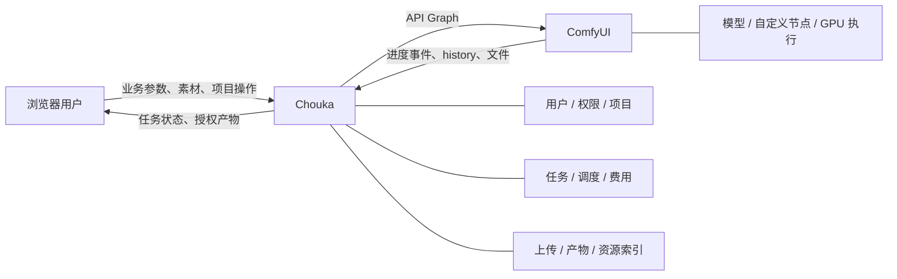

### Chouka 负责

- 浏览器画布和业务参数；
- 用户、项目、ACL 和素材权限；
- Manifest 到 API Graph 的参数注入；
- 任务状态、Worker 调度、产物归档；
- 费用、产能和管理页面。

### ComfyUI 负责

- 校验 API Graph；
- 加载模型和自定义节点；
- 执行节点图；
- 发送执行事件；
- 写入 history 和 output。

### 讲解重点

Chouka 不是新的推理引擎，而是 ComfyUI 之外的业务编排和治理层。

---

# 第 2 页：两种部署形态

## Local 模式

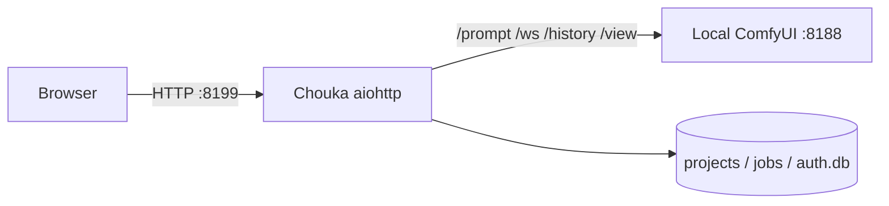

- 入口：`启动抽卡系统.bat`；
- Chouka 服务直接调用本机 ComfyUI；
- 服务端常驻连接 ComfyUI WebSocket；
- 主要用于开发和单机运行。

## Controller 模式

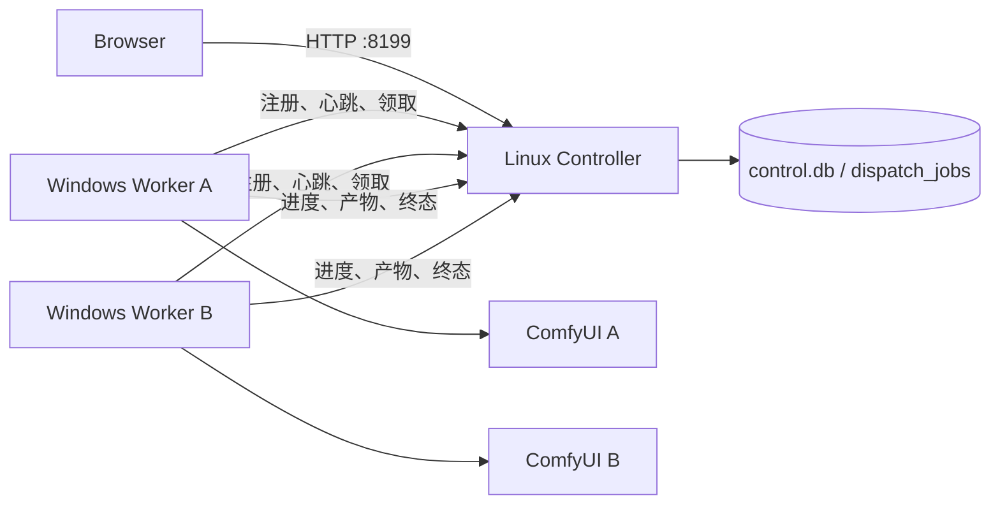

- Controller 不主动远程执行 Windows 命令；
- Worker 主动注册、心跳和领取任务；
- 每个 Worker 调用自己机器上的 ComfyUI；
- 浏览器不直接访问 Worker 或 ComfyUI。

---

# 第 3 页：组件架构

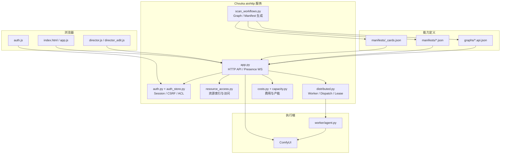

### 关键入口

- 服务端：`server/app.py:make_app()`；
- 前端启动：`web/app.js:boot()`；
- 生成入口：`POST /api/generate`；
- Worker 接口：`/agent/v1/*`；
- 能力加载：`manifests/` + `graphs/`。

---

# 第 4 页：前端运行结构

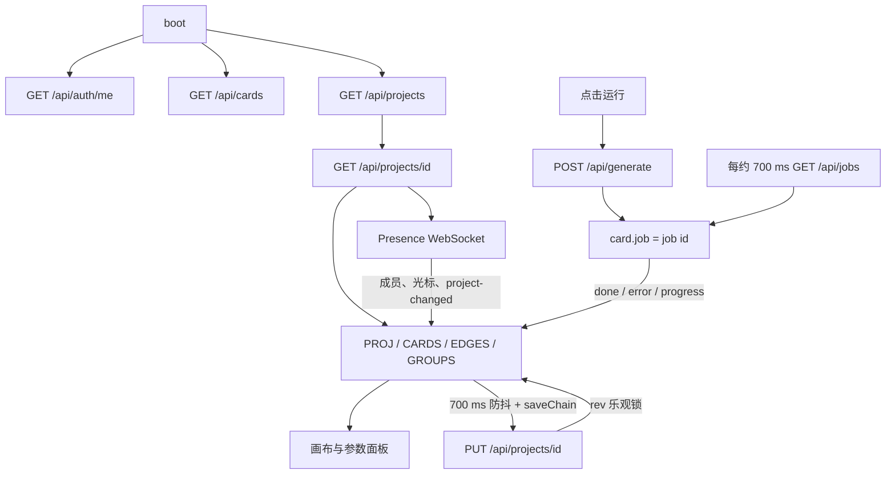

## 前端关键状态

- `PROJ`：当前画布；
- `CARDS` / `CAPS`：卡片和能力定义；
- `TASKS`：当前用户可见的近期任务；
- `saveChain`：串行保存，避免写回乱序；
- `rev`：服务端乐观并发控制。

## 两条实时链路

| 链路 | 协议 | 内容 |
|---|---|---|
| 生成状态 | HTTP 轮询 `/api/jobs` | 排队、进度、错误、结果 |
| 多人协作 | WebSocket `/presence` | 成员、光标、画布变更 |

> Presence WebSocket 不承载生成任务进度。

---

# 第 5 页：服务端生成请求管线

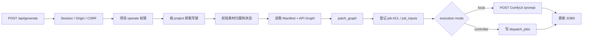

## `patch_graph()` 主要处理

- `target.node/input` 参数注入；
- seed 注入或随机化；
- 上传素材引用替换；
- 必填素材校验；
- 未使用可选支线清理；
- 少量能力专用规则。

## 三类状态不要混淆

1. 浏览器卡片状态；
2. 服务端 `JOBS` 展示状态；
3. Controller `dispatch_jobs` 调度状态。

排查队列问题时，不能只看前端或 `jobs.json`。

---

# 第 6 页：Graph、Manifest 与 Cards 契约

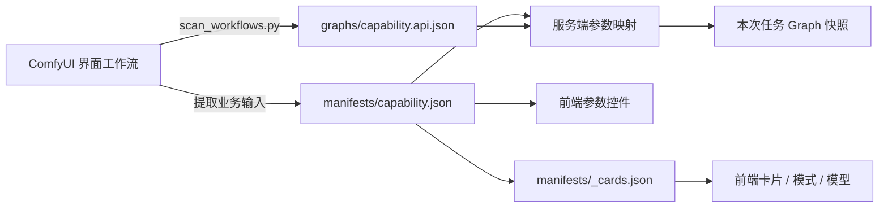

## Manifest 中最关键的契约

```json
{
  "id": "example_capability",
  "graph": "graphs/example_capability.api.json",
  "output": { "node": "99" },
  "inputs": [
    {
      "key": "prompt",
      "type": "textarea",
      "target": { "node": "12", "input": "text" }
    }
  ]
}
```

- `key/type`：前端生成控件；
- `target.node/input`：服务端写入 Graph；
- `output.node`：结果归集；
- `_cards.json`：多个 capability 如何组合成前端卡片。

### 技术约束

- 工作流节点编号变化后必须重新核对 target；
- Graph 中的 `class_type` 必须存在于执行 Worker；
- Graph、Manifest、Cards 应作为一个版本单元发布。

---

# 第 7 页：Local 模式调用时序

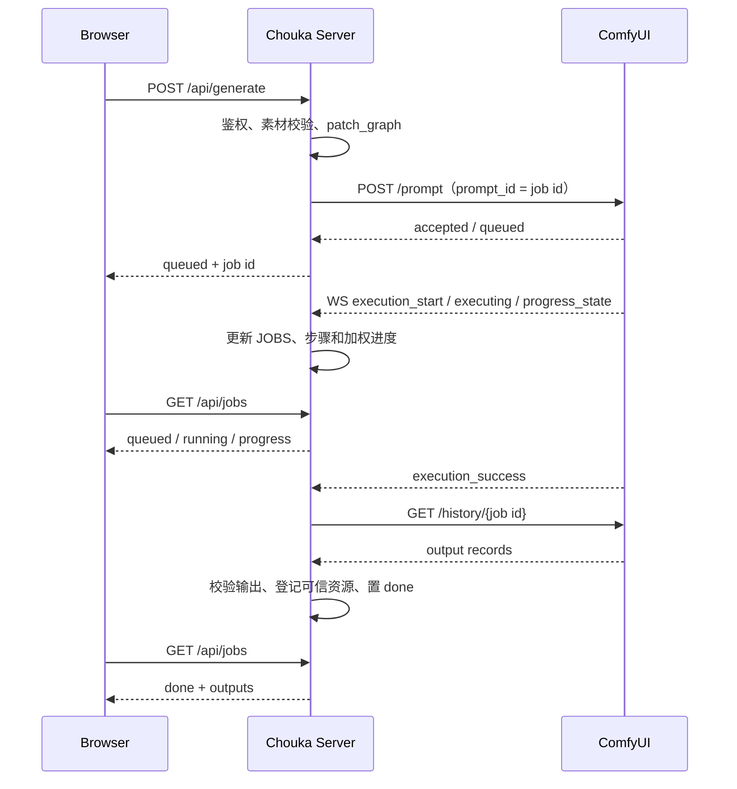

## ComfyUI 接口

| 接口 | 用途 |
|---|---|
| `POST /prompt` | 提交 API Graph |
| `GET /ws` | 执行开始、节点、进度、错误 |
| `GET /history/{id}` | 获取输出记录 |
| `GET /view` | 读取文件 |
| `GET /queue` | 查询或取消相关状态 |
| `GET /object_info` | 获取节点类型 |
| `GET /system_stats` | 获取设备信息 |

> 99% 通常表示节点执行已完成，但 history、文件或资源登记仍在归集。

---

# 第 8 页：Controller / Worker 时序

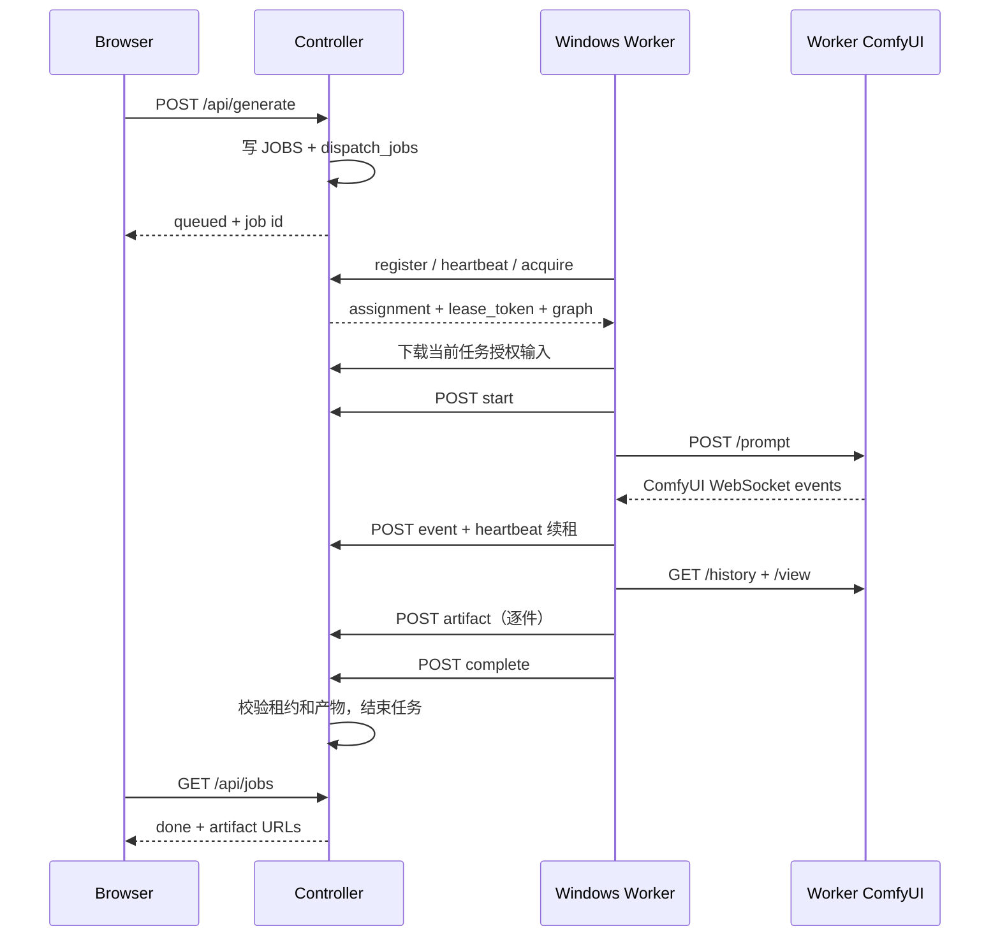

## 租约解决的问题

- 同一任务不能被多个 Worker 同时执行；
- Worker 断线后旧任务可重新派发；
- 旧 Worker 的迟到事件不能覆盖新执行；
- 输入下载、事件和产物上传都绑定当前任务。

远程模式的真正成功终态是 Worker `/complete`，不是 ComfyUI 的执行完成事件。

---

# 第 9 页：Worker 调度条件

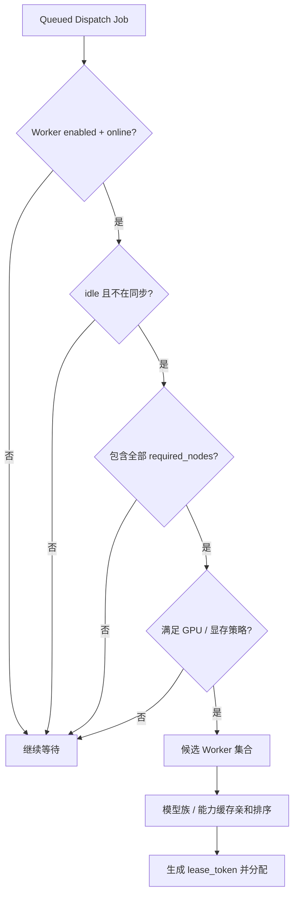

## Worker 心跳上报

- ComfyUI `/system_stats`：GPU 和系统信息；
- ComfyUI `/object_info`：节点 `class_type` 集合；
- ComfyUI `/queue`：本机是否有其他任务；
- 当前任务、租约和同步状态；
- 模型或能力缓存信息。

## 调度边界

节点类匹配只能证明“存在”，不能证明：

- 插件版本一致；
- 模型文件一致；
- ComfyUI 核心补丁一致。

因此仍需要执行环境版本和发布治理。

---

# 第 10 页：状态与存储地图

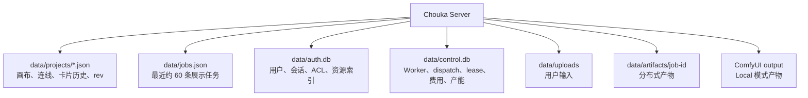

## 常见误区

| 误区 | 实际情况 |
|---|---|
| `jobs.json` 是完整任务账本 | 只保留近期展示数据 |
| 页面 queued 就代表 dispatch queued | 页面和调度是两层状态 |
| `data/artifacts` 包含全部产物 | Local 产物通常在 ComfyUI output |
| 文件存在就能访问 | 还必须存在 `auth.db` 中的可信资源索引 |
| ComfyUI 完成就能显示结果 | 还要完成 history 和资源归集 |

备份时必须同时考虑资源文件、项目 JSON、`auth.db` 和 `control.db`。

---

# 第 11 页：新增能力的技术影响面

## 标准接入流程

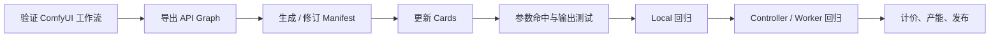

## 变化类型与修改位置

| 变化 | 主要修改位置 | 通常不需要修改 |
|---|---|---|
| 新模型 / 新参数 | Graph、Manifest、Cards | Worker |
| 新自定义节点 | `ComfyUI/custom_nodes`、所有 Worker 环境 | 前端任务协议 |
| 特殊参数注入 | `patch_graph()` 的最小能力规则 | 调度协议 |
| 新输入或产物类型 | 上传、资源索引、Worker 传输 | 仅 Manifest |
| 新 GPU 策略 | `distributed.py`、Worker 遥测 | 画布保存 |
| 新计价规则 | `pricing.json`、`costs.py` | ComfyUI Graph |

## 发布检查

- Graph / Manifest / Cards 同版本；
- 所有目标 Worker 上报所需节点；
- 无素材、可选素材、固定 seed、取消和权限场景通过；
- 明确定价或未定价状态；
- Local 与 Controller 模式均验证。

---

# 第 12 页：后续业务能力扩展架构

> 以下为基于现有底座的规划方向，不代表已经全部实现。

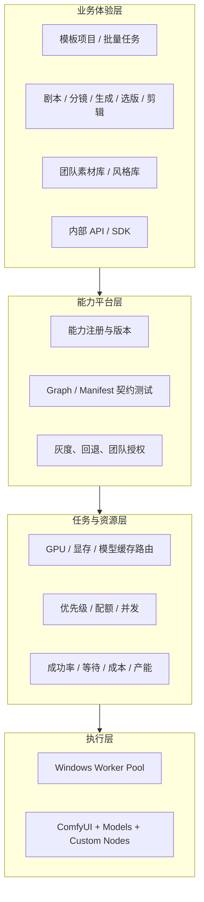

## 三阶段路线

| 阶段 | 建设重点 | 技术目标 |
|---|---|---|
| 第一阶段：标准化 | 能力契约、版本、自动测试、环境清单 | 新能力稳定接入 |
| 第二阶段：生产化 | 模板、批量、素材库、导演链路、质量反馈 | 支撑完整内容生产 |
| 第三阶段：平台化 | 智能调度、API/SDK、配额、计量、运营看板 | 支撑多团队规模化使用 |

## 结论

> Chouka 的核心，是把 ComfyUI 工作流封装成团队可以使用、治理和持续扩展的业务能力平台。

后续扩展应继续保持：前端负责交互、服务端负责编排和治理、Worker 负责远程执行、ComfyUI 负责节点运行。
